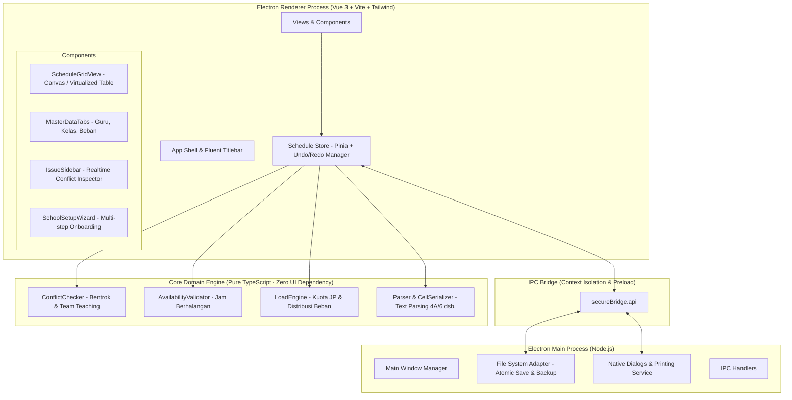

# Architecture & UI/UX Design System
## Proyek: Jadwal Sekolah (Windows Desktop 2026 Edition)

---

## 1. Arsitektur Perangkat Lunak (System Architecture)

Aplikasi dibangun dengan prinsip **Clean Architecture & Separation of Concerns**, memisahkan secara tegas antara logika domain penjadwalan (*Core Engine*) dengan antarmuka pengguna (*UI Presentation Layer*).



### 1.1 Keunggulan Desain Ini
1. **Core Engine Tanpa Ketergantungan UI**:
   * Seluruh logika deteksi bentrok ([`checker.ts`](file:///C:/laragon/www/jadwal-sekolah/src/core/checker.ts)) dan pemodelan data adalah TypeScript murni.
   * Dapat diuji secara menyeluruh melalui unit test (Vitest) secara instan tanpa perlu menjalankan antarmuka grafis Electron.
2. **Keamanan & Stabilitas**:
   * `contextIsolation: true` dan `nodeIntegration: false` pada BrowserWindow untuk mencegah kerentanan keamanan.
   * Komunikasi Main-Renderer hanya melalui kanal IPC tipe kuat (*strictly-typed IPC*).

> **Catatan Scope v1**: Auto-updater **tidak** termasuk cakupan rilis pertama. Aplikasi ini bersifat offline-first dan didistribusikan sebagai installer/portable (lihat `PRD.md` §4.2 & `ADR-0001`), sehingga mekanisme pembaruan otomatis belum didefinisikan kebutuhannya. Jika di masa depan dibutuhkan kanal distribusi update, keputusan tersebut perlu dicatat sebagai ADR baru di `docs/adr/`.

---

## 2. Struktur Modul & Folder Proyek

```
jadwal-sekolah/
├── docs/                     # Dokumentasi PRD, ERD, Design, ADR
├── src/
│   ├── main/                 # Electron Main Process
│   │   ├── index.ts          # Window lifecycle & app initialization
│   │   ├── ipc-handlers.ts   # Handler dialog berkas, cetak, fs
│   │   └── storage.ts        # Atomic file write & 30 rotating backups
│   ├── preload/              # Preload bridge (ContextIsolation)
│   │   └── index.ts          # IPC wrapper yang diekspos ke renderer
│   ├── core/                 # Core Domain Engine (TypeScript Murni)
│   │   ├── types.ts          # Definisi interface & skema data
│   │   ├── checker.ts        # Mesin deteksi bentrok, kapasitas tim, jam kosong
│   │   ├── load-calculator.ts# Kalkulasi beban JP terpasang vs kuota
│   │   ├── cell-parser.ts    # Parser sintaks kode ('4A/6', '13|23')
│   │   └── default-presets.ts# Template jadwal SD, SMP, SMA, SMK (5 & 6 hari)
│   └── renderer/             # Vue 3 Frontend UI
│       ├── assets/           # Font, SVG icon, styles
│       ├── components/
│       │   ├── common/       # Button, Modal, Tooltip, Input, Badge
│       │   ├── grid/         # Interactive schedule table with sticky headers
│       │   ├── sidebar/      # Issue list, Code search with remaining JP
│       │   ├── wizard/       # Multi-step school onboarding dialog
│       │   └── master/       # Tab Beban, Guru (+matrix), Kelas, Pengaturan
│       ├── stores/           # Pinia stores (scheduleStore, uiStore)
│       ├── views/            # MainView, SetupView, PrintPreview
│       ├── App.vue           # Root layout
│       └── main.ts           # Vue entry point
├── tests/                    # Unit testing (Vitest) untuk Core Engine
├── electron-builder.json5    # Konfigurasi packaging exe Windows
├── tailwind.config.ts        # Konfigurasi tema Fluent Design
├── vite.config.ts            # Vite bundler
└── package.json
```

---

## 3. UI/UX Design System (Standar 2026)

### 3.1 Filosofi Desain: *Windows 11 Fluent 2 & High-Efficiency Operator*
* **Efisiensi Tinggi**: Dirancang untuk operator sekolah yang bekerja berjam-jam menyusun ratusan sel jadwal. Tipografi angka seragam (*tabular figures*), kontras sel jelas, dan responsivitas instan tanpa jeda ketik.
* **Modern & Nyaman di Mata**:
  * Mode Gelap (*Dark Mode*) dan Terang (*Light Mode*) dengan transisi halus.
  * Border halus (*subtle borders*), efek kedalaman layer (*elevation*), sudut melengkung modern (*rounded-xl / 8-12px*).
  * Palet warna semantik:
    * **Primary (Accent)**: Emerald / Teal modern (melambangkan validitas & ketenangan data).
    * **Conflict / Error**: Rose-600 / Crimson (kontras tajam untuk sel dan notifikasi bentrok).
    * **Warning**: Amber-500 (untuk jam berhalangan / kode ganda).
    * **Info / Progress**: Indigo-500 (untuk sel terpilih & status sisa JP).
    * **Surface Neutral**: Slate / Zinc (abu-abu netral bebas silau).

### 3.2 Desain Kisi Jadwal (Interactive Grid View)
* **Header Tetap (*Sticky Headers*)**:
  * Kolom nama kelas terkunci di bagian atas saat scroll vertikal.
  * Kolom label hari dan jam terkunci di sisi kiri saat scroll horizontal.
* **Navigasi Keyboard Penuh**:
  * Tombol Panah (Atas, Bawah, Kiri, Kanan): Pindah sel aktif.
  * `Enter`: Buka editor sel atau konfirmasi isi.
  * `Delete` / `Backspace`: Kosongkan sel aktif.
  * `Ctrl + Z`: Batalkan perubahan (Undo).
  * `Ctrl + Y`: Ulangi perubahan (Redo).
  * `Ctrl + C` / `Ctrl + V`: Salin dan tempel kode antar sel jadwal.
* **Visualisasi Sel Dinamis**:
  * Sel Normal: Latar warna pastel sesuai penugasan guru + teks kode tegas.
  * Sel Bentrok: Outline merah berkedip lembut + badge peringatan jumlah kelas bentrok.
  * Sorot Guru Aktif: Memilih salah satu guru di panel samping otomatis menyorot seluruh jam mengajar guru tersebut di kisi jadwal dengan warna aksen kuning/emas.

### 3.3 Panel Inspektur Samping (Sidebar Inspector)
* **Tab 1: Masalah Jadwal (Realtime)**:
  * Pengelompokan cerdas berbentuk akordion:
    * 🔴 **Harus Diperbaiki** (Bentrok guru di jam sama, jam berhalangan dilanggar, kode tidak dikenal, kelebihan jam dari kuota beban).
    * 🟡 **Peringatan** (Kode ganda diampu lebih dari satu guru, rombongan belajar terpisah).
    * 🔵 **Belum Lengkap** (Daftar mata pelajaran yang jamnya belum terplot penuh).
  * Setiap butir masalah memiliki tombol **Lompat ke Sel** yang otomatis menggulirkan kisi dan memfokuskan sel yang bermasalah.
* **Tab 2: Kode & Distribusi JP Guru**:
  * Input pencarian instan (nama guru, mapel, atau kode).
  * Kolom status: Kode, Nama Guru, Mapel, dan **Sisa JP** untuk kelas yang sedang aktif dipilih.
  * Klik dua kali pada daftar kode langsung menempatkan kode tersebut ke sel kisi yang sedang dipilih.

### 3.4 Wizard Penyiapan Sekolah Baru (Multi-Step Onboarding)
Formulir langkah demi langkah berdesain kartu modern:
1. **Identitas**: Input nama sekolah, jenjang, semester, tahun ajaran, dan unggah kop/logo.
2. **Pola KBM**: Pemilih visual 5 hari (Senin–Jumat) atau 6 hari (Senin–Sabtu).
3. **Preset Jam**: Pilihan cepat:
   * *Preset SD/MI* (JP 35 menit, mulai 07.00, istirahat 09.15).
   * *Preset SMP/MTs* (JP 40 menit, mulai 07.00, istirahat 09.40 & 11.40).
   * *Preset SMA/SMK* (JP 45 menit, mulai 07.00, istirahat 10.00 & 12.00).
   * *Kustom Penuh* (Bebas menentukan jumlah JP dan jam istirahat).
4. **Ringkasan & Mulai**: Konfirmasi satu klik untuk membuka lembar kerja jadwal siap isi.
