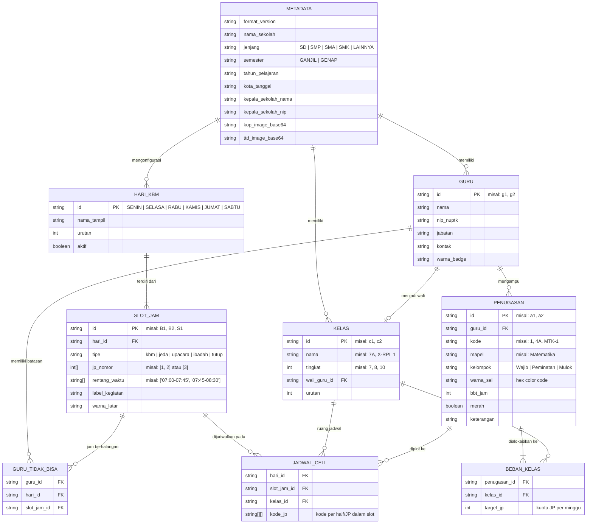

# Entity-Relationship Diagram (ERD) & Data Schema
## Proyek: Jadwal Sekolah

Dokumen ini mendefinisikan model data konseptual, relasional, dan skema JSON untuk berkas proyek `.jadwal`. Meskipun aplikasi bekerja dengan berkas dokumen lokal berbasis JSON, seluruh entitas mempertahankan integritas referensial yang ketat untuk menjamin konsistensi jadwal.

---

## 1. Diagram Relasi Entitas (Mermaid ERD)



---

## 2. Definisi Entitas & Aturan Bisnis

### 2.1 Metadata & Konfigurasi Sekolah
* **`Metadata`**: Menyimpan identitas tunggal sekolah dan informasi cetak.
* Aturan: Gambar kop dan tanda tangan disimpan dalam representasi format data URL (Base64 JPEG/PNG) agar berkas `.jadwal` bersifat *self-contained* (mudah dipindahkan antar laptop tanpa kehilangan aset).

### 2.2 Struktur Hari & Slot Jam (`HariKBM` & `SlotJam`)
* Berbeda dengan versi lama yang mengunci hari dan slot 2 JP, struktur jam kini dinamis:
  * Mendukung 5 hari atau 6 hari belajar.
  * Tipe slot fleksibel:
    * `kbm`: Slot kegiatan belajar mengajar yang dapat diisi kode mapel (bisa berisi 1 JP, 2 JP, atau lebih).
    * `jeda`: Istirahat/ishoma (tidak bisa diisi kode pelajaran).
    * `upacara` / `ibadah` / `kegiatan`: Agenda non-KBM (Upacara, Tadarus, Sholat Dhuha/Jumat, Literasi).
    * `tutup`: Jam kosong non-aktif (ditandai arsiran/hitam pada cetakan).

### 2.3 Guru & Ketersediaan Waktu (`Guru` & `GuruTidakBisa`)
* Satu guru dapat memiliki banyak catatan ketersediaan waktu (`tidak_bisa`).
* Jika sebuah slot jam ditandai dalam `tidak_bisa` guru, mesin pemeriksa bentrok akan memunculkan status `ERROR: tidak_bisa` jika kode guru tersebut ditempatkan pada sel terkait.

### 2.4 Kelas & Beban Mengajar (`Kelas` & `Penugasan`)
* **Relasi Guru & Kode**:
  * Umumnya 1 Guru = 1 Kode Penugasan.
  * 1 Guru dapat memiliki lebih dari 1 Kode jika mengajar lebih dari satu mata pelajaran yang berbeda (misal Guru A mengampu Matematika [Kode `4A`] dan Informatika [Kode `4B`]).
  * *Team Teaching* (Kode Ganda): Lebih dari 1 guru dapat memegang kode yang sama (misal Kode `9` dipegang Guru B dan Guru C untuk PJOK Putra/Putri). Dalam hal ini, sistem mengizinkan kode `9` muncul di kelas berbeda secara bersamaan hingga batas kapasitas jumlah guru pemegang kode tersebut.
* **Beban per Kelas**:
  * Matriks `beban[kelas_id] = target_jp` menentukan jumlah jam tatap muka per minggu untuk kelas tersebut.
  * Pengecekan otomatis membandingkan jumlah kode yang terpasang di grid dengan target JP ini.

### 2.5 Matriks Jadwal (`JadwalCell`)
* Dipetakan dengan struktur hirarkis tiga tingkat:
  `jadwal[hari_id][slot_jam_id][kelas_id] = [ [jp_1_codes], [jp_2_codes], ... ]`
* Format array dua dimensi memungkinkan:
  1. Slot 1 JP: `[["MTK-1"]]`
  2. Slot 2 JP identik: `[["4A"], ["4A"]]`
  3. Slot 2 JP dengan mapel terpisah (*split JP*): `[["4A"], ["6"]]`
  4. Penggabungan/pembagian kelompok siswa (*rombongan terpisah*): `[["PJOK-PA", "PJOK-PI"], ["PJOK-PA", "PJOK-PI"]]`

---

## 3. Format Skema Berkas Proyek (`.jadwal`)

Contoh payload JSON yang disimpan ke disk:

```json
{
  "format_version": 2,
  "app_version": "2.0.0",
  "created_at": "2026-10-18T10:00:00Z",
  "updated_at": "2026-10-18T11:45:00Z",
  "meta": {
    "nama_sekolah": "SMA Negeri 1 Nusantara",
    "jenjang": "SMA",
    "semester": "GANJIL",
    "tahun_pelajaran": "2026/2027",
    "kota_tanggal": "Jakarta, 14 Juli 2026",
    "pejabat_ttd": {
      "jabatan": "Kepala Sekolah",
      "nama": "Dr. H. Sulaiman, M.Pd.",
      "nip": "197203151998021002"
    },
    "kop_base64": "",
    "ttd_base64": ""
  },
  "struktur_waktu": {
    "pola_hari": 5,
    "durasi_jp_menit": 45,
    "hari": {
      "Senin": {
        "aktif": true,
        "judul": "SENIN",
        "slots": [
          { "id": "UP", "tipe": "upacara", "label": "Upacara Bendera", "waktu": "07.00 - 07.45", "jp": [] },
          { "id": "B1", "tipe": "kbm", "label": "", "waktu": "07.45 - 09.15", "jp": [1, 2] },
          { "id": "JD1", "tipe": "jeda", "label": "Istirahat I", "waktu": "09.15 - 09.45", "jp": [] },
          { "id": "B2", "tipe": "kbm", "label": "", "waktu": "09.45 - 11.15", "jp": [3, 4] }
        ]
      }
    }
  },
  "master": {
    "kelas": [
      { "id": "c1", "nama": "X-1", "tingkat": 10, "wali_guru_id": "g1", "urutan": 1 },
      { "id": "c2", "nama": "X-2", "tingkat": 10, "wali_guru_id": "g2", "urutan": 2 }
    ],
    "guru": [
      {
        "id": "g1",
        "nama": "Ahmad Fauzi, S.Pd.",
        "nip_nuptk": "198005122005011003",
        "jabatan": "Guru Matematika",
        "warna_badge": "#3B82F6",
        "tidak_bisa": {
          "Senin": ["B1"],
          "Jumat": ["B3", "B4"]
        }
      }
    ],
    "penugasan": [
      {
        "id": "a1",
        "guru_id": "g1",
        "kode": "1",
        "mapel": "Matematika",
        "kelompok": "Wajib",
        "warna_sel": "#DBEAFE",
        "beban": {
          "c1": 4,
          "c2": 4
        }
      }
    ]
  },
  "jadwal": {
    "Senin": {
      "B1": {
        "c2": [["1"], ["1"]]
      }
    }
  }
}
```
